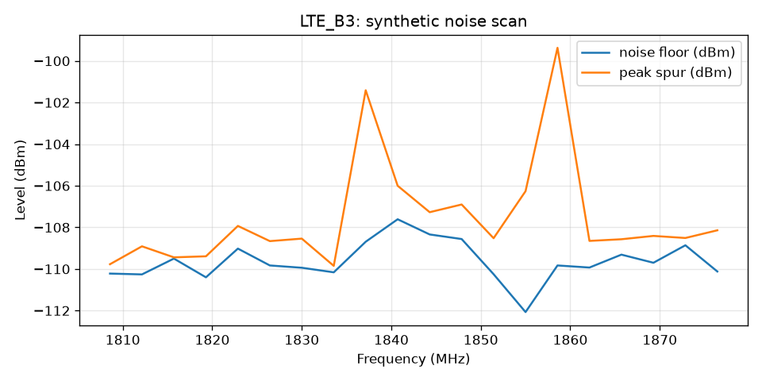

# rf-noise-report

Public, anonymized demo of a one-click RF noise-test report tool.

## What it does

Hundreds of 5G/LTE noise-test log lines take about an hour to turn into charts and a customer-ready report by hand. This tool reads a simple CSV and builds per-band charts plus a short Markdown summary in one command.

On the original internal Excel/VBA tool this cut report prep from about **1 hour to about 2 minutes**. The private version stayed inside the company; this Python demo shows the same idea with **fully synthetic data only**.

## Sample chart



## What information it needs

CSV columns:

- `timestamp`, `band`, `channel`, `freq_mhz`
- `noise_floor_dbm`, `peak_spur_dbm`
- `rbw_khz`, `site`

The included sample uses site label `LAB-SYNTHETIC` only.

## Run (synthetic data only)

```bash
python3 -m venv .venv && source .venv/bin/activate
pip install -r requirements.txt
python report.py
```

Outputs land in `output/` (charts + `report.md`). The sample CSV is fully synthetic. **Do not add real customer or employer logs.**

## License

MIT — see [LICENSE](LICENSE).
