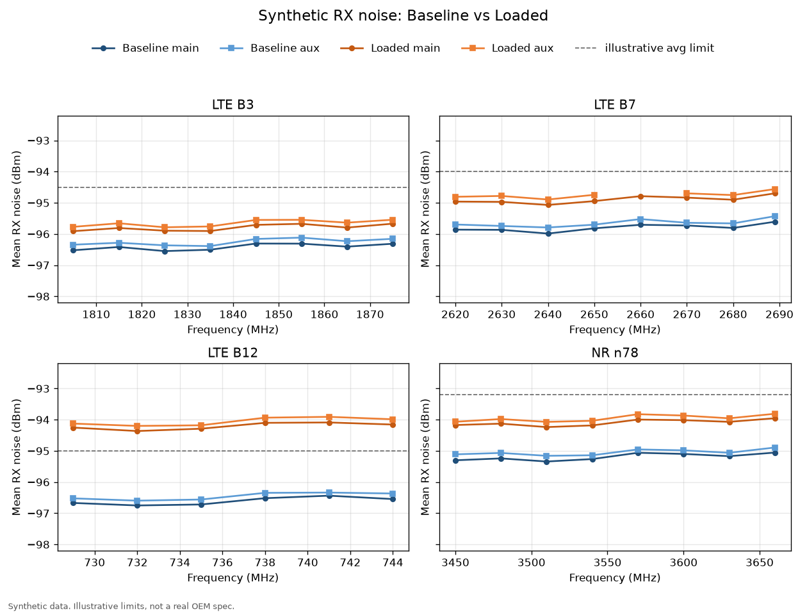

# rf-noise-report

Public demo of a cellular RX noise-power report. Every log in this repo is synthetic. Do not add real customer or employer logs.

The path is the same shape as the production workflow:

1. **Instrument logs.** One raw CSV per band and configuration, with 100 RX samples on each antenna row.
2. **Format bridge.** A Python converter canonicalizes Mode and Band names, renames `RX0001`–`RX0100` to `RX0000`–`RX0099`, pads missing rows onto one channel axis, and writes CRLF text.
3. **Spec check.** Per band and antenna, compare a Baseline unit with a Loaded unit and score average noise, P90 noise, and the delta against an illustrative limit table.
4. **One-page summary.** Pass/Fail, the delta table, and per-band charts of noise versus frequency.

The original production version fed an Excel macro template and cut reporting from about **1 hour to about 2 minutes**. This demo keeps that pipeline and runs the bridge and the report in Python, on synthetic data only.

## Sample chart



LTE B12 on the Loaded unit is shifted high on purpose so the summary shows a Fail. The other bands stay under the sample limits.

## Illustrative limits

These ceilings are **illustrative limits, not a real OEM spec.** A result passes when the Loaded average, the Loaded P90, and the Loaded-minus-Baseline delta are all at or below the row for that band.

| Band | Max average (dBm) | Max P90 (dBm) | Max delta (dB) |
| --- | ---: | ---: | ---: |
| B3 | -94.50 | -94.00 | 2.00 |
| B7 | -94.00 | -93.50 | 2.00 |
| B12 | -95.00 | -94.50 | 2.00 |
| n78 | -93.20 | -92.80 | 2.00 |

The same table is `sample_data/illustrative_limits.csv`.

## Raw instrument columns

Each sample file has two rows per channel (`RxId` 0 = main, `RxId` 1 = aux):

`Time`, `Mode`, `Band`, `BW`, `Channel`, `Frequency`, `StartRB`, `NumRB`, `TARGET_TX_PWR`, `RxId`, `RX0001` … `RX0100`, `RxAGC_Mean`, `RxAGC_95thPercentile`, `RxAGC_Max`

Sample power sits around -97 to -93 dBm. Mode and Band strings in the raw files are deliberately inconsistent (`lte-fdd`, `Band 3`, `5GNR`, `N78`, …). The filename carries the configuration: `Baseline` or `Loaded`.

## Normalized contract

`convert.py` writes `output/normalized/rx_noise_normalized.csv` and one CRLF file per band under `output/normalized/by_band/`.

- `Mode` is `LTE` or `NR`. `Band` is `B3`, `B7`, `B12`, or `n78`.
- Sample headers are `RX0000` … `RX0099` (the instrument's `RX0001` value moves to `RX0000`, through `RX0100` → `RX0099`).
- Added columns: `Config`, `Antenna` (`main` / `aux`), `AxisIndex`, `RowKind` (`meas` or `pad`).
- A missing channel/antenna point becomes a `pad` row with the channel and frequency filled in and the RX samples left blank, so Baseline and Loaded still share one x-axis.
- Line endings are CRLF, which is what the report stage (and the old spreadsheet template) reads.

## Run

```bash
python3 -m venv .venv && source .venv/bin/activate
pip install -r requirements.txt
python report.py
```

`python report.py` runs the bridge and then the report. The other two commands are there when you want a single stage:

```bash
python generate_synthetic.py   # rewrite sample_data/raw (fixed seed)
python convert.py              # raw CSV -> CRLF normalized CSV
```

Outputs land in `output/` (gitignored):

- `normalized/rx_noise_normalized.csv`
- `charts/` — one Baseline-vs-Loaded chart per band, plus `overview.png`
- `summary.md` and `summary.html` — the one-page Pass/Fail summary

## License

MIT — see [LICENSE](LICENSE).
